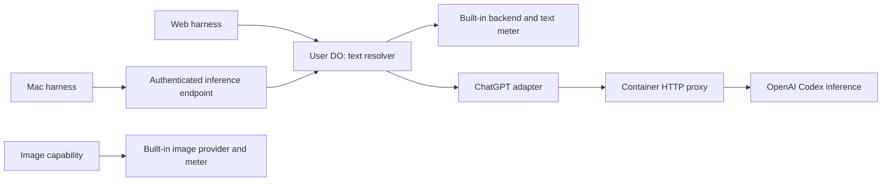

# ChatGPT accounts for Frieren and Mac

Settings → Accounts offers **Use your ChatGPT subscription** on web and Mac.
Connecting and selecting an account are separate actions. Selecting **AI text**
changes inference for agents, app text calls, and soul generation. Each host
keeps its existing prompts, context, files, sessions, and tool execution.

Image generation resolves the built-in provider independently and keeps its
existing quota. A text model can still receive images in its context if it
supports vision. A selected ChatGPT account that fails reports an error;
disconnecting it or explicitly selecting built-in AI returns text to Frieren.
Inference errors never silently spend the built-in text allowance.

## Ownership and credentials

| Data or operation | Owner |
| --- | --- |
| OpenAI credentials and refresh | User's Frieren Durable Object |
| Selected text account and model | Same DO |
| Pending sign-in | Same DO; clients receive only its public progress |
| Agent sessions, context, and tools | Host running the agent |
| Inference forwarding | Cloudflare Container |

Credentials live under `/private/accounts/` in the existing account store, sealed
with `ENCRYPTION_KEY`. They never replicate or enter app state. Both clients use
their Frieren identity to administer the same cloud connection.

`CredentialAccess.read/modify` reads the latest record and holds the store's
per-account update chain across refresh and persistence. Concurrent requests
therefore refresh once. Disconnect and reconnect use the same chain. Reconnection
creates a new credential revision; refresh preserves it. Old backend references
cannot use replaced or deleted accounts.

The container receives an access token for one request, holds it in memory, and
forwards it to OpenAI. It stores no credentials and receives no refresh tokens.
A crash between upstream token rotation and saving the replacement can still
require reconnection; the two services do not share a transaction.

## Sign-in and Settings

The shared Settings app uses these privileged host operations:

| Operation | Behaviour |
| --- | --- |
| `accounts.beginConnect` | Start or return an operation identified by provider and client-generated ID |
| `accounts.readConnect` | Read pending, connected, cancelled, expired, or failed status |
| `accounts.cancelConnect` | Cancel a pending operation |
| `accounts.openConnect` | Read its verification URL and open it in the local browser |

The provider uses Pi's device-code OAuth flow. The GUI displays the code and link,
polls at the requested interval, and offers cancellation, expiry, and retry.
Operations route to the host registering the provider; browser navigation stays
local. Only HTTPS verification URLs from pending operations can be opened.

Pending operations are held in the DO's memory. Duplicate starts return the same
operation, and cancellation prevents a late grant from replacing the account.
Closing the panel requests cancellation. A DO restart expires the operation and
requires another attempt; completed credentials are durable.

Mac composes its local Google/iCloud accounts with cloud AI accounts through the
existing capability WebSocket. It uses the cloud text selection and no longer
runs local ChatGPT OAuth or refresh. Legacy local ChatGPT records are hidden and
retired only after a cloud ChatGPT connection exists. Cloud account IDs use the
`chatgpt:` prefix so they cannot collide with legacy local IDs. Signing out of
Frieren on a device leaves the cloud connection intact.

Settings remains an app in this release. Moving it into the shell is separate.

## Inference

The text resolver returns the existing `AgentBackend` for either provider. Only
the built-in branch uses Frieren's text meter. Mac calls:

| Endpoint | Behaviour |
| --- | --- |
| `GET /api/ai/backend` | Return a sanitized model descriptor and pinned account/model/revision |
| `POST /api/ai/infer` | Validate that selection against the user's account store and stream one inference call |

The transport carries Pi context and an allowlist of generation options as JSON,
then streams assistant events as NDJSON. It accepts no provider tokens, arbitrary
upstream URLs, headers, or callbacks. Tool calls return to the caller for local
execution. Cancellation reaches the upstream request; a stream missing its
terminal event fails instead of reporting a successful partial answer.

A turn pins its backend. Selection changes apply to the next turn; ordinary
refresh leaves the pin valid. Disconnect and replacement invalidate it. The
existing built-in-only `/api/ai/model` and Chat Completions routes remain for
released Mac clients.

The container runs Node HTTPS against the fixed Codex inference endpoint. Its
only paths are `POST /codex/responses` and `GET /health`. The Worker entry in
`worker/codex-proxy-service.ts` requires `PROXY_KEY`. It forwards only provider
headers to OpenAI, excluding the proxy key and Worker forwarding headers.
Request logging is disabled and the image build excludes local environment files.

## Models

The picker shows Codex candidates, not the ChatGPT app's catalogue. Availability
depends on the account. The installed adapter lists GPT-5.6 Sol/Terra/Luna,
GPT-5.5, and GPT-5.3 Codex Spark; GPT-5.4 and mini are excluded. Luna is the proposed
default and still needs its integrated live access check. The list is static,
not filtered by account entitlements. Access errors never silently substitute a
different model.

The transport was demonstrated with a live account, but is not a stable public
third-party subscription API. Model references checked 2026-09-08:
[OpenAI models](https://learn.chatgpt.com/docs/models) and
[availability by product and identity](https://learn.chatgpt.com/docs/enterprise/workspace-model-availability).

## Release order and verification

1. Deploy `wrangler.codex-proxy-service.jsonc` with `PROXY_KEY`. The verification
   service is deployed at `https://frieren-codex-proxy.xiaoxing-hu9889.workers.dev`.
2. Configure the same key as `CODEX_PROXY_KEY` in each Frieren environment.
   `CODEX_PROXY_URL` is the proxy origin, with no `/backend-api` suffix. Keep
   `ENCRYPTION_KEY` stable; losing it requires users to reconnect.
3. Publish the updated app SDK, update Settings' dependency and lockfile, and
   publish Settings. Its standalone CI currently uses an older SDK without the
   new account operations and image capability. Advance the host's submodule to
   the final Settings commit.
4. Deploy Frieren before releasing Mac. A new daemon against an old server asks
   for an update instead of reverting to local ChatGPT auth.

Automated checks cover encrypted persistence, concurrent refresh, revoked grants,
unknown models, cancellation, credential invalidation, tool results, transport
validation, interrupted streams, and independent image resolution. Frieren and
Mac builds passed. Browser smoke covered the sign-in entry, code progress,
cancellation, and opening OpenAI. The Mac capability client read the same cloud
provider/account catalogue.

An earlier standalone probe passed live streaming, a Worker tool round-trip,
and token refresh, then discarded its grant. Its source and deployment configs
have been removed from this change. The production adapter still needs fresh
authorization for the integrated model-access, web text, and Mac tool checks.
Native Mac UI sign-in also remains to be exercised. No production account has
been connected or migrated during development verification.
