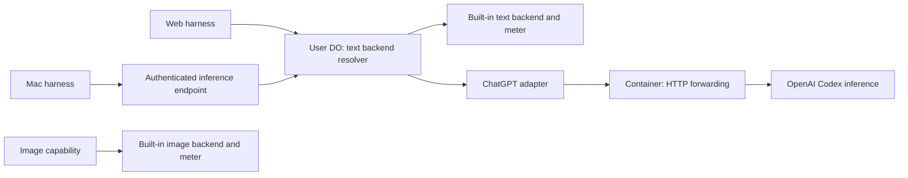

# ChatGPT accounts for Frieren and Mac

Proposed design, 2026-09-08. Based on the current account/capability implementation
and the successful [container POC](CODEX-POC.md). This document describes the
implementation to build; these changes are not deployed.

## Outcome

Settings → Accounts offers **Use your ChatGPT subscription** on both web and Mac.
The same interactive sign-in component connects one cloud-owned ChatGPT account.
Selecting its **AI text** capability changes inference for the agent, app text
calls, and supporting text work. Each host continues running its own harness,
context assembly, files, sessions, and tools.

Images have an independent provider. Initially they continue using Frieren's
built-in image backend and its existing quota. A text provider switch cannot
remove image generation.

## Ownership: one grant in the cloud

Keep OpenAI credentials in the signed-in user's Frieren Durable Object, under
`/private/accounts/`, using the existing secret codec with a required cloud sealing
key. The DO owns acquisition, refresh,
model access, and disconnect. Both Settings clients read its account projection
and administer that same connection using the user's Frieren identity.

| Data or operation | Owner | Other hosts receive |
| --- | --- | --- |
| OpenAI access/refresh tokens | User's Frieren DO | Nothing |
| Refresh execution | Same DO, serialized per account | Result of the inference request |
| Connected account and status | Same DO | Credential-free account projection |
| Selected text account/model | Same DO | Current backend descriptor |
| Pending sign-in | Same DO | Opaque operation ID, code, link, status |
| Agent sessions, files, tools | Host running that agent | Existing replication behaviour |
| OpenAI inference transport | Shared container service | Streamed model output |

This provides a shared account experience without credential replication. Syncing
refresh tokens would leave multiple hosts able to refresh the same grant before
either sees the other's update. A single owner removes that distributed race;
the owner still needs to serialize concurrent refresh attempts within itself.

The container receives a request's access token in memory and forwards it to
OpenAI. It stores no credentials and receives no refresh token. Scaling or
restarting containers therefore does not change credential ownership.

The selected text account is cloud-owned too. Both clients read and modify the
same selection; no second replicated preference or competing local AI pointer is
needed for this feature. Local Google/iCloud connections retain their current
ownership and behaviour.

## Separate text and image

The runtime already has separate `ai.generateText` and `image.generateImage`
contracts. Preserve those names to avoid changing every app. The change is their
provider resolution:

- `ai` resolves the selected text account, defaulting to built-in Frieren AI when
  there is no selection.
- `image` resolves the built-in image provider independently. It never reads the
  text selection.
- Add `image` to the Accounts capability projection and label the two services
  **AI text** and **Images** in Settings. The built-in account can show text
  inactive and images active while ChatGPT text is selected.
- With only one image provider, derive that default. Do not add an image selection
  file or a second model picker until there is another image provider to select.

This is a separation of inference services, not a ban on image input: a text model
that supports vision can still receive images in its context. Image generation
continues through the image capability.

## Shared interactive sign-in

Keep the provider auth hint `interactive`. Introduce a connection operation for
auth that needs user interaction, while retaining the existing immediate form
connection path for iCloud and other form providers.

The Settings admin contract gains three operations:

| Operation | Input | Result |
| --- | --- | --- |
| `accounts.beginConnect` | provider ID, client-generated operation ID | Pending sign-in projection |
| `accounts.readConnect` | operation ID | Pending, connected, cancelled, expired, or failed |
| `accounts.cancelConnect` | operation ID | Acknowledgement |

A pending projection contains the operation ID, verification URL, user code,
expiry, and suggested polling interval. Connected contains the account ID. Failure
contains a safe, actionable message. Tokens, device-auth secrets, and OAuth
responses never enter this projection or the Settings reducer state.

The provider's host-only acquisition interface needs an abort signal and a small
interaction callback. Its existing acquisition result remains the verified
account plus credentials. The host translates Pi's device-code notification into
the pending projection; the provider continues owning the OAuth protocol.

The Settings GUI holds the operation ID and progress in component state. It calls
`beginConnect`, shows the code and an **Open OpenAI sign-in** action, polls status,
and renders cancel/retry/expiry. Browser navigation is a host operation: web opens
a browser tab and Mac opens the system browser. Do not rely on an iframe popup or
on the launcher's link handler also being installed in mini-app windows. Add a
local `accounts.openConnect` Settings host action that accepts the operation ID,
reads its verification URL, and opens it; the GUI does not supply an arbitrary
OAuth destination. Verify browser user-gesture/popup behaviour and native mini-app
navigation explicitly, with a visible copy-link fallback if opening is blocked.

On completion, write the account first, reload Accounts, and offer **Use for AI
text** with the model picker. Connecting and selecting remain separate operations,
matching the existing “connect, then choose what it powers” pattern. Failed or
cancelled operations preserve the working credential. Closing the panel requests
cancellation and stops its local status polling; expiry bounds abandoned flows.

Use the POC's Pi device-code flow initially. The DO retains its running acquisition
task while the UI makes short status requests; no browser HTTP request waits for
the entire sign-in. Starting again with the same operation ID must return the
same running/result operation, including after an RPC retry. Poll at the upstream
interval and stop on cancellation, expiry, or completion.

Pi currently exposes a running login operation rather than a durable resumable
polling state machine. V1 can recover a lost UI connection while that operation
is alive; if the DO restarts during sign-in, report that the operation expired and
let the user retry. Do not claim sign-in survives deployment/restart. Completed
credentials are durable. Supporting restart-resumable acquisition later would
require persisting the private device flow state and implementing resumable polling.

The operation belongs to the authenticated Frieren user. Its final account write
must check cancellation/supersession so a late completion cannot reconnect an
account the user has already cancelled. Expired operation records are removed.

## Mac uses the same account service

Remove the local ChatGPT provider from the Mac registry and retire its loopback
login and token-refresh runtime. Mac requires its existing Frieren sign-in to use
this cloud account. Signing out of Frieren removes that device's access; it does
not disconnect the user's cloud ChatGPT connection.

Wire the existing `settingsHost.remote` seam to the user's cloud capability
session. The same shared Settings app then renders local Google/iCloud accounts
and the cloud ChatGPT account. There are two routing changes:

1. New connection operations route to the host offering that provider. The current
   Settings host always connects locally when local Accounts exists, even if the
   provider only came from the remote list. Route remote-only providers remotely.
2. Cloud AI selection uses the cloud account service. The Mac's built-in AI facade
   must not appear as a second independently selected text account next to the
   cloud built-in account. Present the cloud account projection for AI and retain
   the local facade only as an implementation detail during migration.

For existing local ChatGPT connections, show a one-time reconnect action for the
cloud flow. After a successful cloud connection, retire that Mac's old local
record and selection. Do not upload the local refresh token or silently keep
refreshing it. Existing local non-ChatGPT accounts are unaffected.

Namespace new cloud ChatGPT account record IDs, for example
`chatgpt:<OpenAI-account-id>`, and retain OpenAI's original ID in the private
credential for upstream headers. This prevents a legacy local record with the
bare OpenAI ID from intercepting cloud disconnect/selection through the current
local-first mutation routing during migration.

## One text backend resolver, two harnesses

In Frieren, introduce one host-owned text resolver and use it for agent sessions,
app `ai.generateText`, and soul generation. Agent compaction and other helpers
already built from an `AgentBackend` continue using that backend. Keep the
built-in provider's construction over the platform backend so resolving it cannot
recursively resolve itself.

The ChatGPT branch constructs Pi's Codex backend over the cloud account and sets
its inference base URL to the container service. Both branches return the same
existing `AgentBackend` interface. Only the built-in branch uses Frieren's text
meter; ChatGPT inference uses the user's OpenAI subscription allowance.

Mac needs a remote `AgentBackend` adapter. Its existing `/api/ai` gateway only
supports the fixed platform model via Chat Completions; replacing the upstream
URL with Codex Responses would not work. Add a small transport at the existing
backend interface instead of translating between two vendor wire protocols:

| Endpoint | Behaviour |
| --- | --- |
| `GET /api/ai/backend` | Return a sanitized selected model descriptor and an opaque backend reference |
| `POST /api/ai/infer` | Accept that reference, Pi context, and allowed generation options; stream the model's assistant events |

Authenticate with the Mac's Frieren identity and route to that user's DO. The
backend reference identifies an account/model/credential generation owned by that
user; it is not an access credential. The server validates it and obtains the
OpenAI token itself. No client-supplied provider token, upstream URL, or arbitrary
headers are accepted.

Keep this protocol narrow: a versioned NDJSON envelope over Pi assistant events,
including text, reasoning, tool-call events, final message/usage, and errors.
Serialize an explicit set of generation options such as reasoning and output
limit; callbacks, credentials, transport overrides, and runtime objects are not
wire data. The client reconstructs an `AssistantMessageEventStream`; its
`completeFn` awaits the same stream's terminal result. An interrupted stream
without a terminal result is an error, not a successful partial completion.

Mac continues to assemble prompts and execute tools locally. A model tool call
travels back to Mac, which runs it and sends the resulting context in the next
inference request. The cloud endpoint performs one model request per call and
does not start an agent, execute tools, or persist a second session.

Resolve the descriptor at the start of a turn and keep its backend fixed for that
turn. A selection change applies to the next turn; a request already streaming
can finish. Validate a pinned reference against its account ownership, model
support, and credential generation on each request. Disconnect or replacement
invalidates it; ordinary token refresh does not. Old references must not restore
deleted accounts. This requires the host resolver to resolve a validated pinned
selection as well as the current selection.

Preserve the existing metered `/api/ai/model` and Chat Completions routes for older
Mac clients until the new client ships. They keep their existing built-in-only
meaning during rollout.

## Refresh correctness

Extend the host-only AI lease with an account identity and credential read/modify
operations over the single account store. The ChatGPT adapter implements Pi's
`CredentialStore` over those operations. Do not build independent in-memory token
stores from credential snapshots for each request.

Implement modification inside `AccountStore.update`'s existing asynchronous
per-account chain: read the latest credential, recheck expiry, refresh if needed,
seal and save the result, then release the chain. The next concurrent caller
sees the fresh grant. Other accounts remain independent. Acquisition remains
outside this chain because it waits for a person; a refresh holds it only for a
bounded token request and storage write. Never call back into the same store from
inside its update callback.

Use a persisted non-secret credential generation for reconnect/replacement,
separate from token expiry. Preserve it during refresh and advance it when a new
grant replaces the old one. Include account identity, model, and generation in
backend identity so cached backends cannot keep using a replaced account.

Coordinate disconnect and reconnect writes through the same store. The container
does no refresh. A crash after OpenAI rotates a token but before its replacement
is saved can still require reconnection; a local lock cannot make an upstream
OAuth exchange and local storage one transaction.

## Model selection and errors

Show Codex models supported by the adapter, with account availability reflected
where verified. Do not promise parity with the ChatGPT app's picker.

Current Pi candidates include GPT-5.6 Sol/Terra/Luna, GPT-5.5, and GPT-5.3 Codex
Spark. Astra is in the current official catalogue but absent from this installed
Pi version. GPT-5.4 and mini remain in Pi and mini passed the POC; official docs
nevertheless retire them for ChatGPT-authenticated Codex, so exclude them from new
defaults. Start with Luna as the proposed default, subject to an authenticated
model-access check during implementation.

The current provider `models()` callback is synchronous and has no account input.
Make model discovery an asynchronous, account-aware host operation if returning
an entitlement-filtered list. Verify the authenticated Codex catalogue request
through the container before relying on it: the POC only tested inference, not
model discovery. If discovery is unavailable, present a curated supported list
as candidates and verify a selection; do not label every static entry as available
to that account. Do not substitute models silently on an access error.

For a connected selected account with an expired/revoked grant, exhausted allowance,
or unavailable model, keep the selection and show the relevant error/reconnect
action. Offer an explicit switch to built-in AI. Do not silently consume Frieren
quota after a ChatGPT inference error. Explicit disconnect returns text to the
built-in default; images retain their provider and existing quota throughout.

Sources checked 2026-09-08: [OpenAI models](https://learn.chatgpt.com/docs/models)
and [model availability by product and identity](https://learn.chatgpt.com/docs/enterprise/workspace-model-availability).
The raw Codex transport remains a dependency demonstrated by the POC, not a
promise of a stable third-party subscription API.

## Implementation slices and verification

1. Decouple image resolution from the text account; project **AI text** and
   **Images** separately in Accounts. Prove selecting ChatGPT leaves images usable.
2. Add the shared interactive connection operations and GUI. Replace the Worker
   placeholder with the cloud ChatGPT provider. Verify cancel, expiry, duplicate
   begin, lost UI connection, and late completion after cancellation.
3. Add store-backed refresh coordination and the common text resolver. Verify
   simultaneous agent/app refresh, disconnect/reconnect races, app text, soul
   generation, model changes, and separation of built-in quota from BYO text.
4. Connect Mac Settings to cloud Accounts and add the remote backend transport.
   Verify cloud connection visibility on both clients, remote-only provider
   routing, local Google/iCloud behaviour, and a real Mac tool round-trip.
5. Migrate local ChatGPT connections, validate supported model access, and finish
   end-to-end tests with web and Mac concurrently using the same cloud grant.

Keep the container's fixed-destination streaming implementation from the POC.
Production ingress is authenticated from the Frieren Worker, preferably through
a service binding, and is not exposed as an unauthenticated forwarding endpoint.
It preserves cancellation and never logs authorization headers or request bodies.
Verify the production binding route still passes the same inference probe; the
POC used an authenticated workers.dev hop. OAuth and model-account coordination
stay outside this transport service.

Primary implementation locations: `packages/app/capabilities/accounts/`,
`packages/app/capabilities/settings/`, `apps/settings/src/`,
`platform/frieren/worker/frieren.ts`, `platform/frieren/worker/frieren.app.ts`,
`platform/frieren/worker/accounts/`, and `platform/mac/daemon/{kernel,platform-ai,chatgpt}.ts`.
Put the small shared inference transport types/client beside `AgentBackend` in
`packages/agent`; keep the HTTP server and provider credentials in Frieren.

The older `apps/settings/DESIGN.md` describes replicated credentials and a retired
integration architecture. This proposal follows the current host-private account
implementation instead; replace that obsolete guidance when implementation lands.
