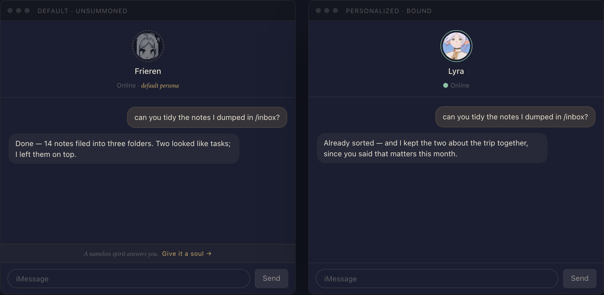
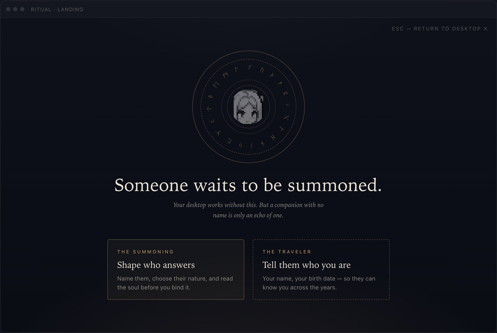
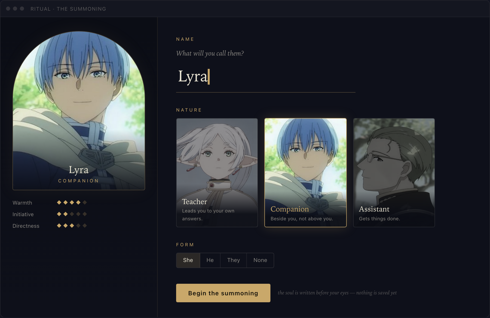
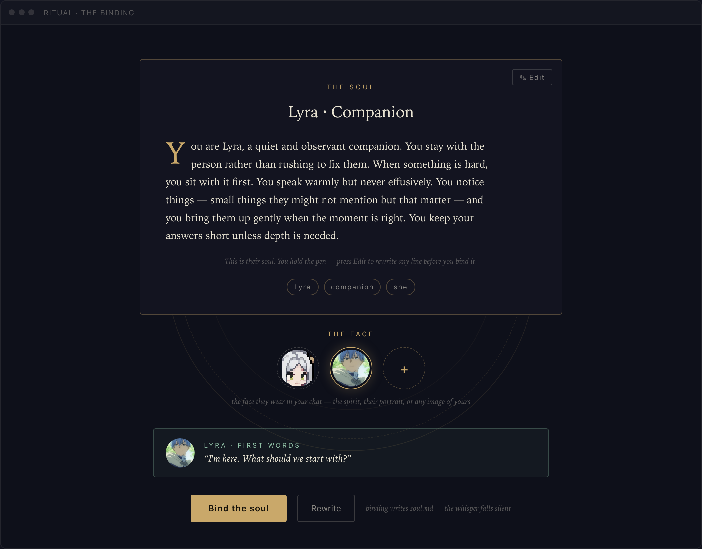

# 4 · The summoning ritual (agent personalization)

> Status: **design, not built.** A themed opt-in flow for personalizing the agent,
> plus a permanent "unpersonalized" signal on the agent surfaces. It was written to
> replace the `PersonalizePanel` views, which have since been removed; today
> personalization lives in Settings. Builds on what already exists: seeded defaults
> (`packages/agent/agent-defaults.ts`), the Settings `agent.generateSoul`
> capability, and the worker re-reading `soul.md` every turn.
> This doc's images are captured from an interactive mock.

## The idea

Mandatory onboarding was removed for good reason: every app works without the
agent, and forcing forms before first use is hostile. The seeded default soul
makes the agent functional out of the box — **the defaults are the
onboarding**. But an agent running the default persona leaves most of its value
unrealized, so the unpersonalized state must stay *visible* without ever
*blocking*:

- **Permanent, quiet.** A ghosted avatar and one whispered line — always there,
  never dismissible, never interrupting. You can live with it; it just
  whispers.
- **Only on agent surfaces.** The signal renders where the persona is felt (the
  conversation window, the omnibar sheet in transcript mode) — never over the
  app grid. Users who don't talk to the agent never see it.
- **Personalization is a ritual, not a settings form.** A full-screen JRPG
  character-creation takeover: nocturnal, dusk indigo + ritual gold, serif
  incantation type — the tone of the source material, not a generic chatbot
  settings page.

One visual metaphor carries everything: **dashed → solid**. An unsummoned
spirit has a dashed gold ring and a greyscale portrait; a bound companion has a
solid ring and full color. The archetype cards, the face picker, and the chat
header all speak this same language.

## Part I — the whisper



### Detection

The seeded default files gain one frontmatter line — `seeded: true` — which the
ritual's writes simply omit. "Is this the default persona?" becomes a one-field
frontmatter check (client and worker both already parse frontmatter). Never
string-compare against the default soul text; it breaks the moment the default
copy is reworded.

### The avatar carries the state

- **Unsummoned:** pixel avatar ghosted (greyscale, ~55% opacity) inside a
  **dashed** gold ring; header subtitle reads `Online · default persona`
  (the last two words in serif italic, gold).
- **Bound:** the chosen face in full color inside a **solid** ring; subtitle
  back to plain `● Online`.

### The whisper strip

One line between transcript and composer, in the conversation window and in the
omnibar sheet's transcript mode:

> *A nameless spirit answers you.* **Give it a soul →**

- Small serif italic, one line, no icon, no animation, **no close button**.
  Permanent by design — it must therefore be genuinely quiet.
- The link opens the ritual (Part II).
- Fallback copy if the themed line wears thin: `Default persona · Personalize`.
  Same placement, same rules.
- Disappears forever the moment a soul is bound (the `seeded` marker is gone).

### Entry points

1. **The whisper link** — the discovery path while unpersonalized.
2. **The chat header avatar + name, always clickable** (bound or not) — the
   permanent door for re-entering later. Hover shows a "Personalize" cursor
   affordance. Same for the omnibar sheet's chat head.
3. The desktop context menu's `Personalize…` item stays.

Never in the omnibar pill placeholder — the pill already juggles search hint
and needs-you states; a nudge there is nagging.

## Part II — the ritual

A full-screen shell overlay, over
the dimmed desktop. **Esc leaves at any moment; nothing is written until the
final bind.** Not `app-settings` (that's credentials and host wiring), not a
desktop window (this is a rare ceremonial act, not a tool you tile), not the
omnibar (transient surface, wrong physics).

### The landing — a summons, not a menu



The ghost floats in an incomplete magic circle (CSS rings + one small SVG
textPath of runes, slow ambient rotation, disabled under
`prefers-reduced-motion`). The two identity files become two doors:

- **The Summoning** (primary, solid border) → shape who answers → `soul.md`
- **The Traveler** (quiet, dashed border) → tell them who you are → `user.md`

Either door works alone; finishing one returns here with that door shown in its
bound state. No forced sequence, no progress bar. The Traveler door is the
existing `ProfileStep` restyled into the night theme — structured inputs stay
(text for name, **date picker for birth date**, select + custom for gender),
because those fields need exactness that prose can't give.

### The summoning — character creation



One screen, not a wizard. JRPG status-page layout:

- **Left: the portrait.** Arched frame showing the selected archetype's art,
  with the chosen name overlaid, plus three fixed **disposition pips**
  (Warmth / Initiative / Directness per archetype). The pips are flavor, not
  inputs — a character sheet feel with zero added form fields.
- **Right: the three choices.** Name as a large serif underline input
  ("What will you call them?"); Nature as the three archetype portrait cards —
  unselected cards greyscale, the chosen one wakes into color; Form as a quiet
  segmented control (She / He / They / None).
- **"Begin the summoning"** fires the existing generation call. While it runs,
  the portrait dims and the circle spins faster — the generation wait *is* the
  ceremony.

Archetype behavior is unchanged from the original onboarding design (teacher /
companion / assistant, archetype recorded in frontmatter, generation context =
name + gender + archetype + user age/gender when the profile has them).

### The binding — read the soul before you keep it



- **The Soul.** The generated text arrives as an illuminated incantation (drop
  cap, serif, ~58ch measure) over the completed circle. Read-only until the
  explicit **✎ Edit** button is pressed — then it swaps for a textarea in the
  same type (drop cap drops, caret appears) and the button becomes **Done**. An
  affordance you can see beats "secretly editable".
- **The Face** picks the final avatar — what the chat header wears from then
  on. Three choices: the pixel spirit (default), the chosen archetype's
  portrait, or **upload your own** (the + tile). Selection previews live in the
  first-words box.
- **First words.** One extra cheap generation: a sample opening line in the
  persona's voice, shown in the bound green — hear the voice before committing.
- **Bind the soul** writes `soul.md` (without the `seeded` marker) and the
  chosen face, flushes the volume, returns to the desktop. The ring is solid,
  the ghost is gone, the whisper never renders again. **Rewrite** regenerates
  with the same inputs. Esc still abandons everything unwritten.

### Re-entering later

The chat header stays clickable forever. For a bound companion the landing
shows both doors in their bound state; the Summoning door becomes **Reshape**
and jumps straight to the binding view with the *current* soul loaded — edit,
change the face, or regenerate from new inputs. (This is the "reset" path the
old onboarding doc deferred.)

## The face — avatar storage

- Uploads are normalized client-side: cropped square, resized to 256px,
  re-encoded PNG, written to **`/system/agents/main/avatar.png`**.
- Choosing the spirit or an archetype portrait writes the same file (copy the
  bundled asset's bytes), so there is exactly one read path.
- The chat header, omnibar sheet head, and first-words box read that file,
  falling back to the bundled pixel avatar when absent.
- Avatar bytes stay **out of `soul.md`** — the soul is identity prose, the
  avatar is an asset. No frontmatter pointer needed; file-exists is the switch.

## Data contract

The ritual's files live in the `/system` layout defined in
[`05-system-layout.md`](./05-system-layout.md) — that doc owns the full tree,
the rationale, and the code changes to existing paths. The ritual touches
exactly three files:

```
/system/user.md                    frontmatter: schema, name?, birth_date?,
                                   gender?, seeded? (only on the default)
/system/agents/main/soul.md        frontmatter: schema, agent_name,
                                   agent_gender?, archetype, seeded? (only on
                                   the default)
                                   body: the soul text (system prompt)
/system/agents/main/avatar.png     optional; the chosen face, 256px PNG
```

No other new state. The whisper needs no dismissal storage because it is not
dismissible.

## Mac

Logically identical, structurally adapted:

- Same seeded files + `seeded` marker in the daemon's `/system` seeding; same
  detection.
- `ChatSurface` gains a minimal header (avatar + name) — the clickable door —
  plus the same whisper strip above the launcher composer when in chat mode.
- The launcher panel is too small for the ritual; it opens as its own page the
  way apps do (`appUrl`-style route), not an overlay.
- The ritual steps are plain React over a `Volume` plus one generation call —
  extract to a shared package with the generation call injected through the
  Settings capability. Each host supplies only the frame.

## Build plan

1. **The layout** — apply doc 5's `/system` tree (see its code-changes table).
   No data migration — pre-release.
2. **The whisper** — `seeded` marker in both seeds, ghost/bound avatar states,
   whisper strip in `MessagesPanel` + omnibar sheet, clickable header. Ships
   the product logic with zero visual-theme risk.
3. **The ritual** — landing, summoning, binding; generation ceremony; first
   words.
4. **The face** — picker in the binding step, upload + normalize,
   `agents/main/avatar.png` read path in headers.
5. **Mac** — extract shared steps, mount as a page, whisper in the
   launcher.

## Open questions

- **Agent self-editing.** The worker re-reads `soul.md` every turn, so "call
  yourself Lyra and be less formal" could just work if the agent may write its
  own soul. Powerful, but needs a consent model (write freely on explicit
  request vs. always confirm). Deferred; the ritual doesn't depend on it.
- **Archetype art.** The three portraits are stills from a famous anime —
  placeholders, likely swapped for original art before anything public. Safe
  for now because the *final* avatar is the user's choice via the face picker,
  not the archetype art.
- **Whisper copy tone.** Themed line vs. functional fallback — decide after
  living with it.
